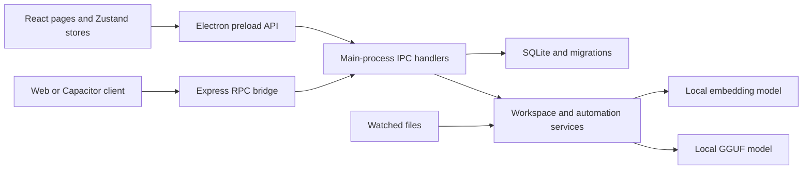

# CogniTwin

A substantial Electron/React personal-workspace prototype backed by SQLite. The repository includes notes, projects, tasks, ingestion, semantic search, a knowledge graph, flashcards, automation, scripting and simulation services. Its broad source implementation is distinct from a verified, secure packaged product.

## Source architecture



The diagram describes source relationships. It is not a successful desktop/mobile deployment capture.

## What is in the code

- `src/main/database/` initializes SQLite, attempts the `sqlite-vec` extension, applies schema/migrations and provides fallback schemas.
- `src/main/ipc/handlers.ts` exposes workspace, database, search, LLM, automation and other handlers to Electron and an Express bridge.
- `src/main/services/` contains local file watching/indexing, chunking, embeddings, model integration, classification, graph enrichment, scheduling, data import/export, encryption and plugins/scripts.
- `src/renderer/src/` contains React pages, components and Zustand stores. `android/` is a Capacitor shell and requires a separate Android build toolchain.
- `simulation.service.ts` implements state forecasting, randomized completion simulations and weighted decisions. These are exploratory models, not validated predictions of a person's behavior or capacity.

Embedding generation is configured to refuse remote models, but requires local model assets. GGUF inference also needs a compatible local artifact. The download scripts are explicit network operations and are not run by these instructions.

## Security and data boundaries

Do not use this prototype with sensitive data or expose it on a network. The HTTP RPC bridge is disabled by default. If explicitly enabled, it binds only to `127.0.0.1` and requires a bearer token on every dispatched request. It still forwards privileged handlers, including arbitrary SQL and scripting capabilities: possession of this token grants workspace-level access, not a restricted user role or sandbox. The local login screen is separate from bridge authentication. Remote access needs a separate authorization design.

For a trusted local browser development session only, generate a random token (for example `node -e "console.log(require('node:crypto').randomBytes(32).toString('hex'))"`). Set `COGNITWIN_RPC_TOKEN` in the Electron process environment to that value; at least 32 bytes are required. Set `COGNITWIN_RPC_ORIGIN` to the exact loopback HTTP origin of your renderer, such as `http://localhost:5173`. Other browser origins are rejected; CORS is never wildcard. Keep both values out of committed files, build-time frontend variables and logs. In that renderer's developer console, set `sessionStorage.setItem('cognitwin-rpc-token', '<your generated token>')`. Remove the item when finished; never paste a token into an untrusted page. This manual bridge is for local development, not mobile/network deployment. The browser bridge uses port 3000; `PORT` may change the server port for other trusted local clients.

Encryption helpers use AES-GCM and Electron safeStorage when available, but contain an unencrypted-key fallback and are not evidence that every database field is encrypted. Privacy blur is a display feature. Overwrite-based deletion is not a verified secure erase guarantee on SSDs, backups or journaled filesystems. Earlier claims of absolute privacy, military-grade protection and safe third-party sandboxing have been removed.

Watchers can read local files and trigger indexing. Scheduler, imports, scripts and plugins can have side effects. Review those services before running. For audits use a fresh, empty Electron user-data directory and synthetic files; do not point this app at personal Documents/browser/email stores.

## Development

```sh
npm ci --ignore-scripts
npm run typecheck
```

Installation initially disables lifecycle scripts. Desktop execution additionally requires an Electron-compatible native `better-sqlite3` build and an Electron binary; review `postinstall` before intentionally running it. Once native dependencies and local assets are prepared, `npm run dev` starts Electron and its services. `npm run build` typechecks and bundles; packaging scripts invoke electron-builder. The builder configuration still contains example metadata/update URLs and needs release-specific configuration.

## Focused regression and status — 2026-11-09

With Node 24 (built-in TypeScript stripping):

```sh
node --test tests/text-chunker.test.mjs tests/rpc-access.test.mjs
```

Two tests pass. The original chunker emitted an extra overlap-only chunk after covering the final character; the repair stops at the end of the source, avoiding redundant embeddings/search entries. The regression was observed failing before repair. This test runs the real dependency-free chunker; it does not initialize Electron, SQLite or an ML model.

The RPC follow-up adds nine checks (2026-11-10). Six server regressions failed against the original registration function before repair; all now pass. Three renderer checks cover missing-token rejection, bearer headers for both call paths, and streaming HTTP failures. Server tests execute the actual TypeScript registration function with inert Express/Electron boundaries and a synthetic handler. They verify default-off behavior, loopback binding arguments, token/origin rejection and malformed bodies without starting a socket or privileged service. These checks do not establish a successful packaged Electron run or a complete IPC security audit.

Full install/build, desktop behavior and Android packaging remain **unverified**. `npm ci --ignore-scripts` failed with Windows `EPERM` while creating dependency directories. An elevated lifecycle-disabled retry was stopped after sustained machine contention. A renderer-only Vite probe then failed with `spawn EFTYPE` from the partially installed esbuild binary; Electron and its services were never started. No personal data or models were loaded. Existing files in `resources/screenshots/` have not been recaptured or authenticated by this audit, so they are not presented here as current runtime evidence. Use the source diagram above until a clean isolated run can be captured.
